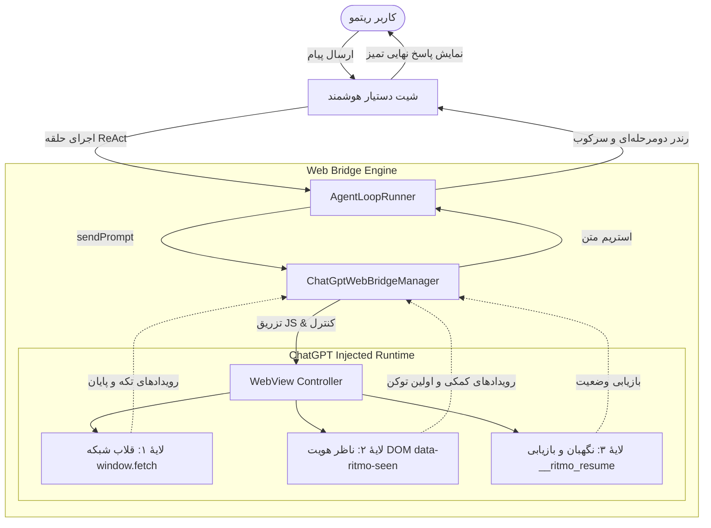
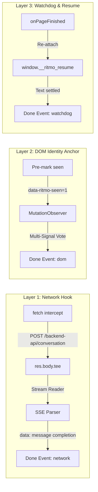
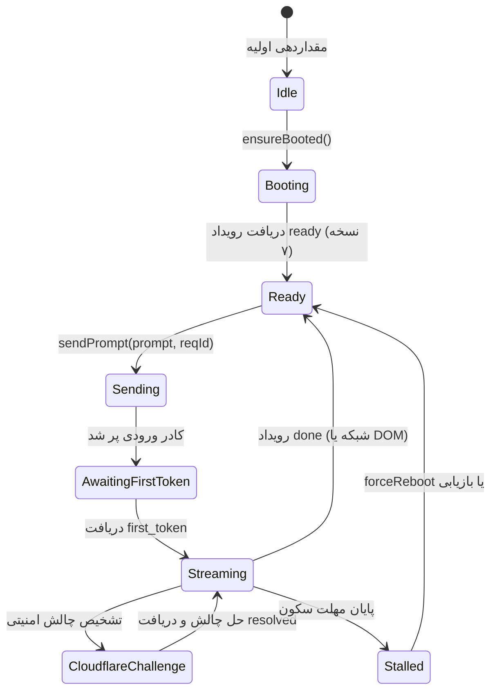
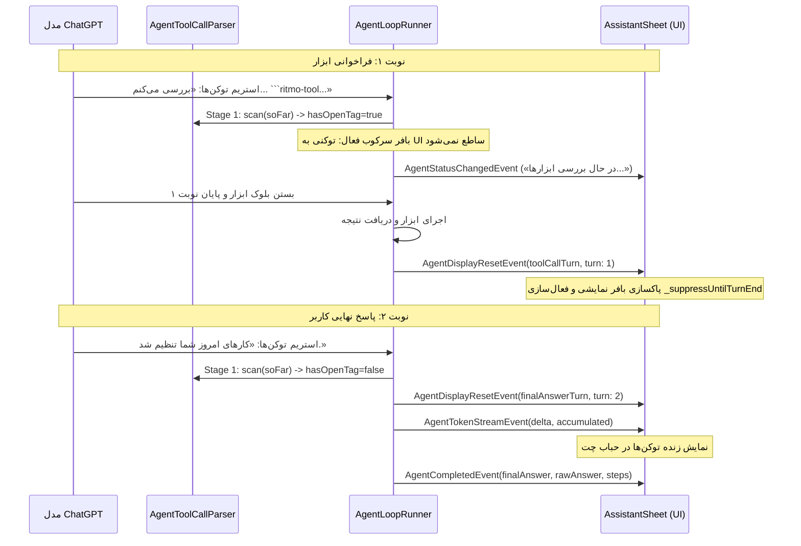

# مستند جامع معماری پل وب چت‌جی‌پی‌تی و پروتکل ضدرندر (ChatGPT Web Bridge Architecture)

> **نسخه:** ۲.۰  
> **دامنه:** `lib/core/ai/web_bridge/`، `lib/core/ai/agent/`، `lib/core/ai/chat/`، `lib/features/assistant/`  
> **هدف:** برقراری ارتباط پایدار، دوطرفه، مقاوم در برابر تغییرات DOM و ضدرندر میان ریتمو و رابط وب ChatGPT بدون نیاز به کلید API مستقیم.

---

## ۱. فلسفهٔ طراحی و اهداف معماری

پل وب چت‌جی‌پی‌تی ریتمو به کاربر اجازه می‌دهد از قابلیت‌های پیشرفتهٔ مدل‌های بزرگ زبانی بدون نیاز به پیکربندی کلیدهای API تجاری یا سرورهای واسط استفاده کند. این پل بر بستر یک مرورگر پنهان (`webview_flutter`) کار می‌کند و با تزریق کدهای جاوااسکریپت بهینه‌شده و همگام با چرخهٔ حیات فلاتر، تبادل داده را مدیریت می‌کند.

### اصول بنیادی:
1. **عدم مسدودسازی تجربهٔ کاربری:** وب‌ویو در پس‌زمینه فعالیت می‌کند و پیش‌نمایش زنده تنها بیننده (`viewer`) است، نه راه‌انداز (`booter`).
2. **تشخیص سه‌لایهٔ پایان:** هیچ پاسخی به دلیل تغییر یک selector یا تغییر ظاهر سایت گم نمی‌شود.
3. **سرکوب کامل ردپای ابزارها:** فراخوانی ابزارها و محاسبات میانی مدل هرگز به کاربر نشت نمی‌کند.
4. **تک‌منبعی بودن زمان‌بندی‌ها:** مقادیر تایم‌اوت و انتخاب‌گرها در جداول متمرکز تعریف می‌شوند.



---

## ۲. سیستم تشخیص سه‌لایهٔ پایان پیام (3-Layer Completion Detection)

یکی از پیچیده‌ترین چالش‌های وب‌بریج، تشخیص دقیق لحظهٔ شروع و پایان تولید پاسخ است. ریتمو از معماری سه‌لایهٔ مکمل بهره می‌برد:



### لایهٔ ۱: قلاب شبکه (`window.fetch` Interception) — مرجع اصلی
- **بسته‌بندی یکپارچه:** در ابتدای مقداردهی سند، تابع اصلی در `window.__ritmo_origFetch` ذخیره شده و `window.fetch` رهگیری می‌شود.
- **تطبیق نشانی:** مسیرهای `/backend-api/conversation`، `/backend-anon/conversation` و `/backend-api/f/conversation` با زیررشته بررسی می‌شوند (بدون سنگینی Regex).
- **دوشاخه‌سازی بدنه (`res.body.tee()`):** پاسخ اصلی مستقیماً به کلاینت وب داده می‌شود تا رندر طبیعی سایت مختل نشود، و شاخهٔ دوم توسط خوانندهٔ جریان SSE ریتمو مصرف می‌شود.
- **نگاشت کد HTTP:** کدهای وضعیت (۴۰۱/۴۰۳ برای لاگین، ۴۲۹ برای محدودیت نرخ، ۵xx برای خطای سرور) فوراً به خطای نوع‌دار تبدیل می‌شوند.

### لایهٔ ۲: لنگر هویت DOM با ناظر جهش (`MutationObserver`) — پشتیبان زنده
- **لنگر هویت (`data-ritmo-seen`):** پیش از ارسال پرامپت جدید، تمام پاسخ‌های قبلی دستیار مهر «دیده‌شده» می‌خورند. پیام هدف اولین پیامی است که این مهر را ندارد؛ بدین ترتیب پیام‌های یکسان متوالی هرگز دچار اشتباه نمی‌شوند.
- **جایگزینی پول ۱۰۰ میلی‌ثانیه‌ای:** `MutationObserver` با throttle ۱۲۰ میلی‌ثانیه‌ای تغییرات ساختار و متن را رصد می‌کند.
- **رأی چندسیگنالی ۴گانه (Multi-Signal Completion Vote):**
  1. حذف کلاس استریم از گرهٔ هدف (`.result-streaming`).
  2. ظاهر شدن ردیف دکمه‌های پایانی (کپی، بازتولید، بازخورد).
  3. بازگشت دکمهٔ ارسال و محو شدن دکمهٔ توقف.
  4. سکون متن برای مدت زمان تعیین‌شده (۹۰۰ میلی‌ثانیه در صورت تأیید سایر سیگنال‌ها، ۲۵۰۰ میلی‌ثانیه در سکون صرف).
  - اعلام پایان نیازمند **حداقل ۲ رأی موافق** و طول متن مثبت است.

### لایهٔ ۳: نگهبان همبستگی و بازیابی (`RequestId` & `__ritmo_resume`)
- **شناسهٔ یکتا (`req_...`):** تمام رویدادها در JS و Dart با شناسهٔ درخواست همبسته می‌شوند؛ رویدادهای کهنه بی‌درنگ دور ریخته می‌شوند.
- **ماشین حالت `_PendingRequest`:** وضعیت درخواست شامل مراحل `sending`، `awaitingFirstToken`، `streaming` و هش پیام ذخیره می‌شود.
- **بازیابی سه‌حالته در `__ritmo_resume`:**
  - **الف)** پاسخ در صفحه کامل است -> ارسال فوری `done` با منبع `watchdog`.
  - **ب)** پاسخ در حال تولید است -> اتصال مجدد ناظر و ارسال `resumed`.
  - **ج)** پیام در صفحه نیست -> درخواست تک‌بارهٔ `resend_required`.

---

## ۳. چرخهٔ حیات وب‌ویو و پایدارسازی (Lifecycle & Resilience)



### گاردهای کلیدی پایداری:
1. **منع ریبوت در میانهٔ تولید (WEB-01):** در وضعیت‌های `generating` و `cloudflareChallenge` هرگونه فراخوانی مجدد راه‌اندازی مسدود می‌شود.
2. **کارت پیش‌نمایش فقط بیننده (WEB-02):** `attachViewer()` فقط کنترلر موجود را متصل می‌کند و وضعیت تولید را بازنشانی نمی‌کند.
3. **گارد نسخه‌دار خودتوان‌تکرار (WEB-03):** عدد نسخه (`__RITMO_BRIDGE_V = 7`) در سند بررسی می‌شود؛ در صورت انطباق، رویداد `ready` گرم بدون بازسازی ناظرها ساطع می‌شود.
4. **وصل مجدد پس از ناوبری (WEB-04):** رویداد `onPageFinished` به‌طور خودکار وضعیت معلق را به صفحه متصل می‌کند.
5. **مهار تایمر بی‌کاری (WEB-06):** تایمر خروج وب‌ویو در طول تولید متوقف است.

---

## ۴. پروتکل ضدرندر ابزار و رندر دومرحله‌ای (Anti-Render & Turn Suppression)

برای اجرای فرامین ایجنتی (خواندن تقویم، ذخیره برنامه، ثبت خلق و خو)، مدل هوش مصنوعی ابزارها را فراخوانی می‌کند. متن این فراخوانی‌ها و جملات برنامه‌ریزی هرگز نباید به کاربر نشان داده شوند.

### سه‌شکل فراخوانی ابزار (WEB-28):
1. **بلوک کد نشانه‌دار (فرم ترجیحی وب):**
   ````text
   ```ritmo-tool
   {"tool": "create_task", "parameters": {"title": "مطالعه"}}
   ```
   ````
2. **نشانهٔ کمیاب متنی:**
   `⟦RITMO_TOOL⟧{"tool": "get_agenda", "parameters": {}}⟦/RITMO_TOOL⟧`
3. **تگ ساختاریافته (سازگار با API):**
   `<tool_call>{"name": "log_mood", "parameters": {"score": 5}}</tool_call>`

### جریان رندر دومرحله‌ای با بافر سرکوب (WEB-32 تا WEB-34):



---

## ۵. جدول مرکزی انتخاب‌گرها و نگاشت خطاهای نوع‌دار

### جدول متمرکز `RITMO_SELECTORS` (`chatgpt_js_injector.dart`):
تمامی دسترسی‌ها به عناصر صفحه صرفاً از توابع امن `querySafe` و `queryAllSafe` با جدول زیر انجام می‌پذیرد:

| کلید انتخاب‌گر | اهداف اصلی |
|---|---|
| `composer` | `#prompt-textarea`, `textarea`, `div[contenteditable="true"]`, `.ProseMirror` |
| `sendButton` | `button[data-testid="send-button"]`, `button[aria-label="Send prompt"]` |
| `stopButton` | `button[data-testid="stop-button"]`, `button[aria-label="Stop generating"]` |
| `assistantMessage` | `[data-message-author-role="assistant"]`, `article[data-testid*="assistant"]` |
| `userMessage` | `[data-message-author-role="user"]`, `article[data-testid*="user"]` |
| `markdownBody` | `.markdown`, `.prose`, `div[class*="markdown"]` |
| `turnActionButtons` | `[data-testid="copy-turn-action-button"]`, `button[aria-label*="Copy"]` |
| `streamingIndicator`| `.result-streaming`, `.streaming`, `[data-is-streaming="true"]` |
| `loginButton` | `button[data-testid="login-button"]`, `a[href*="/login"]` |
| `cloudflare` | `iframe[src*="cloudflare"]`, `#cf-turnstile`, `#challenge-stage` |

### کدهای خطای نوع‌دار `WebBridgeErrorCode`:

| کد خطا | پیام فارسی کاربر | دکمه اقدام پیشنهادی |
|---|---|---|
| `noFirstToken` | چت‌جی‌پی‌تی پیام را گرفت اما شروع به پاسخ نکرد. | یک بار دیگر بپرس |
| `stalled` | پاسخ در میانهٔ کار متوقف شد. | ادامه بده یا دوباره بپرس |
| `loginRequired` | برای ادامه باید وارد حساب ChatGPT شوی. | ورود به حساب |
| `rateLimited` | سقف پیام چت‌جی‌پی‌تی پر شده است. | کمی بعد دوباره تلاش کن |
| `cloudflare` | برای ادامه باید تایید امنیتی را کامل کنی. | باز کردن پنجرهٔ تایید |
| `hardTimeout` | پاسخ بیش از حد طول کشید و متوقف شد. | تلاش مجدد |
| `composerLocked`| کادر پیام چت‌جی‌پی‌تی قفل ماند. | باز کردن مرورگر زنده |

---

## ۶. بررسی امنیتی و ضداحراز هویت

1. **مقاومت در برابر تزریق (WEB-31):** تمامی ورودی‌های کاربر پیش از ارسال از طریق `AgentToolProtocol.sanitize` فیلتر می‌شوند تا از تزریق تگ‌های `<tool_call>`، `[TOOL_CALL]`، `<system>` یا بلوک‌های کد جعلی جلوگیری شود.
2. **محرمانگی اطلاعات:** کوکی‌ها، توکن‌های احراز هویت و محتوای خام مکالمات هرگز در سیستم لاگ ثبت نمی‌شوند (صرفاً متاداده، طول رشته و شناسه‌های درخواست لاگ می‌شوند).
3. **لغو دوطرفه (WEB-11):** در هنگام انصراف کاربر، هم ناظر جاوااسکریپت غیرفعال می‌شود (`__ritmo_detach`) و هم دستور فیزیکی توقف تولید به سایت فرستاده می‌شود (`__ritmo_stopGeneration`).
