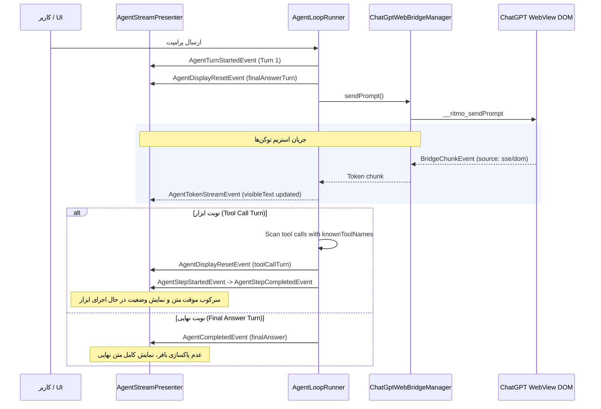

# راهنمای جامع معماری تاب‌آوری پل وب هوش مصنوعی ریتمو (Ritmo Web Bridge Resilience Guide)

## ۱. مقدمه و اهداف معماری
پل وب هوش مصنوعی ریتمو (`ChatGptWebBridgeManager`) وظیفه برقراری ارتباط پایدار، دوطرفه و بدون وقفه بین کلاینت فلاتر و رابط وب ChatGPT را بدون نیاز به کلید مستقیم API بر عهده دارد. با اجرای اصلاحات جامع فازهای ۶ تا ۹، ۵ گلوگاه ریشه‌ای که پیش از این منجر به نمایش صفحهٔ سفید یا سکوت پاسخ می‌شدند به طور کامل برطرف شده‌اند.

---

## ۲. تشریح ۵ ریشهٔ شکست و راهکارهای حل‌شده

### شکست اول: قفل سرسخت منبع داده (Source Lock Stalemate)
- **مشکل ریشه‌ای**: استریم از طریق `fetch`/SSE شروع می‌شد اما به دلیل بافر شدن میانی یا قطعی، متوقف می‌شد. منبع روی `sse` قفل بود و چانک‌های کامل دریافتی از `dom` دور ریخته می‌شدند.
- **راهکار پیاده‌شده**:
  1. افزودن تایم‌اوت شکست سکوت ۴ ثانیه‌ای (`sourceRelockSilence = 4s`).
  2. در صورت سکوت ۴ ثانیه‌ای، قفل منبع شکسته شده و چانک‌های منبع مقابل پذیرفته می‌شوند.
  3. ارتقای رویدادهای `done` حاوی متن بلندتر با منبع رقیب به برداشت پایانی معتبر (`done_promoted`).

### شکست دوم: سقوط خطا بدون برداشت نجات (No-Salvage Aborts)
- **مشکل ریشه‌ای**: در مواجهه با قطعی شبکه، خطای HTTP یا تایم‌اوت، استریم فوراً بسته می‌شد و محتوای تولیدشده در صفحه از دست می‌رفت.
- **راهکار پیاده‌شده**:
  1. پیاده‌سازی متد `_harvestForSalvage`.
  2. قبل از بستن استریم یا گسیل خطا، متن موجود در DOM با سقف ۶ ثانیه برداشت شده و در صورت وجود، به عنوان پاسخ جزئی (`isPartial: true`) با بنر هشدار به کاربر تحویل داده می‌شود.

### شکست سوم: ترتیب نادرست رویدادهای ریست در ایجنت (Turn Reset Collision)
- **مشکل ریشه‌ای**: رویداد `AgentDisplayResetEvent(finalAnswerTurn)` پس از اتمام استریم فرستاده می‌شد که در برخی سناریوها بافر نمایش را پاک می‌کرد.
- **راهکار پیاده‌شده**:
  1. پاکسازی `_isSuppressed = false` در `AgentStreamPresenter` به محض دریافت `AgentTurnStartedEvent`.
  2. گسیل `AgentDisplayResetEvent(finalAnswerTurn)` *قبل* از ورود به حلقهٔ استریم.
  3. گسیل `AgentDisplayResetEvent(toolCallTurn)` منحصراً در صورت شناسایی فراخوانی ابزار.

### شکست چهارم: تداخل بلوک‌های کد مارک‌داون معمولی (Code Fence False Positives)
- **مشکل ریشه‌ای**: بلوک‌های ```json معمولی حاوی کد یا راهنمای کاربر به اشتباه فراخوانی ابزار تلقی شده و از صفحه پنهان می‌شدند.
- **راهکار پیاده‌شده**:
  1. محدودسازی نشانه‌های مجاز ابزار به `ritmo_tool`، `tool_call` و `tool`.
  2. مستثنی‌کردن قطعی بلوک‌های `json`، `python` و `dart` از فنس‌های ابزاری.

### شکست پنجم: عدم اعتبارسنجی نام ابزار در JSONهای برهنه (Unchecked Bare JSON)
- **مشکل ریشه‌ای**: متون JSON عمومی با ساختار کلید-مقدار ساده گاهی به عنوان ابزار پردازش می‌شدند.
- **راهکار پیاده‌شده**:
  1. انتقال فهرست ابزارهای مجاز نوبت جاری (`knownToolNames`) به متدهای پارسر.
  2. اعتبارسنجی قطعی نام ابزار قبل از هرگونه استخراج؛ در صورت عدم تطابق با ابزارهای مجاز، متن دست‌نخورده به عنوان پاسخ متنی به کاربر نشان داده می‌شود (Fail-Open).

---

## ۳. جریان رویدادها در چرخهٔ اجرای ایجنت



---

## ۴. رابط تشخیصی و ابزارهای مانیتورینگ زنده

### صفحهٔ تشخیص پل وب (`WebBridgeDiagnosticsScreen`)
- **مسیر ناوبری**: `/bridge-diagnostics`
- **روش‌های دسترسی**:
  1. لمس طولانی (Long-Press) روی `BridgeStatusChip` در سربرگ چت یا شیت دستیار.
  2. دکمهٔ «مشاهدهٔ وضعیت و تشخیص پل وب» در تنظیمات هوش مصنوعی (`AiConnectionScreen`).
  3. کلیک روی `BridgeStatusChip` در وضعیت قرمز خطا.
- **قابلیت‌ها**:
  - مانیتورینگ زنده چرخه حیات، نسخه پل، منبع فعال و طول انباشتگر.
  - تست خودکار سلامت سلکتورهای رابط کاربری DOM.
  - اکشن برداشت دستی مستقیم پاسخ از مرورگر (`harvestVisibleAnswer`).
  - راه‌اندازی مجدد اجباری پل (`forceReboot`).
  - مشاهده و کپی ردیاب ۳۰ رویداد اخیر (`BridgeTraceLog`).

---

## ۵. چک‌لیست پایداری و نگهداری

1. **قاعدهٔ Fail-Open**: هیچ متنی نباید به صفحهٔ سفید منتهی شود؛ در صورت تردید، متن همیشه نمایش داده می‌شود.
2. **عدم بلعیدن خطا**: تمام شرایط غیرعادی باید در `BridgeTraceLog` با سطح `warn` یا `error` ثبت شوند.
3. **انباشتگر تک‌مرجع**: متن همیشه به صورت افزایشی در `BridgeResponseAccumulator` نگهداری می‌شود و انقباض‌های ناخواسته DOM نادیده گرفته می‌شوند.
