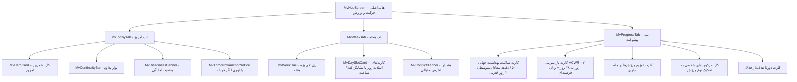
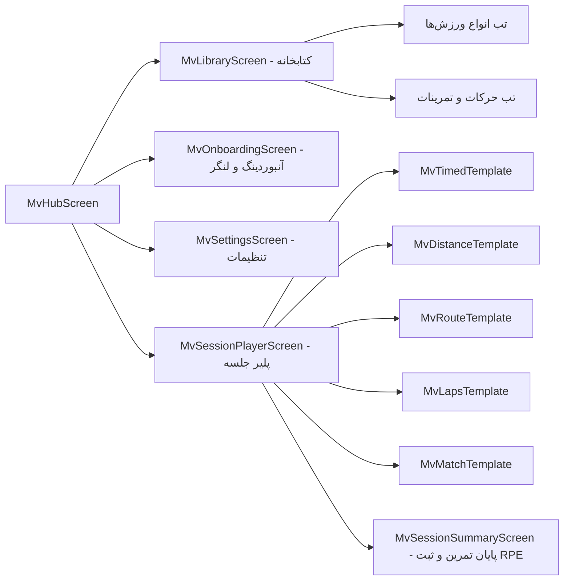

# معماری اطلاعات و ناوبری ورزش تکمیلی ریتمو v2 (Information Architecture & Navigation)

این سند نقشهٔ ساختاری کامل هاب ورزش، تب‌ها، شیت‌های کنش، درخت مسیرها و ماتریس ناوبری صفحه-به-شیت را طبق استانداردهای N-01 تا N-09 و ADR-0008 تشریح می‌کند.

---

## ۱. ساختار هاب و تب‌های اصلی



---

## ۲. فهرست شیت‌ها و دسترسی‌ها

| نام شیت | فایل | شناسه l10n | کاربرد اصلی | نحوهٔ فراخوانی |
| :--- | :--- | :--- | :--- | :--- |
| `MvDayPlanSheet` | `presentation/sheets/mv_day_plan_sheet.dart` | `mv_day_plan_title` | ویرایش اسلات روز، انتخاب نوع، تعیین ساعت و تبدیل به لنگر | تپ روی اسلات در تب هفته یا دکمهٔ تغییر |
| `MvQuickLogSheet` | `presentation/sheets/mv_quick_log_sheet.dart` | `mv_quick_log_title` | ثبت سریع جلسهٔ انجام‌شده با ۴ چیپ اخیر و دسترسی به انتخابگر | دکمهٔ «ثبت سریع» در هاب و تب امروز |
| `MvKindPickerSheet` | `presentation/sheets/mv_kind_picker_sheet.dart` | `mv_kind_picker_title` | انتخاب کامل از ۴۹ ورزش با جستجوی ۲۵۰ میلی‌ثانیه‌ای، فصلی و اخیر | از شیت‌های برنامه روز، ثبت سریع و کتابخانه |
| `MvCustomKindSheet` | `presentation/sheets/mv_custom_kind_sheet.dart` | `mv_custom_kind_title` | ساخت و ذخیرهٔ ورزش سفارشی جدید با ۷ پارامتر | گزینهٔ «ورزش جدید دلخواه» در انتخابگر ورزش |
| `MvCantTodaySheet` | `presentation/sheets/mv_cant_today_sheet.dart` | `mv_cant_today_title` | جابجایی روز، لغو جلسهٔ عادی یا اکشن «این هفته لغو شد» برای لنگر | اکشن «امروز نمی‌توانم» در کارت هیرو امروز |
| `MvQuickCheckinSheet` | `presentation/sheets/mv_quick_checkin_sheet.dart` | `mv_quick_checkin_title` | ثبت سریع خواب، درد و خستگی جهت محاسبه آمادگی | تپ روی نوار آمادگی در تب امروز |
| `MvExerciseSubstitutionSheet` | `presentation/sheets/mv_exercise_substitution_sheet.dart` | `mv_substitution_title` | تعویض حرکت بر اساس ۴ علت (سختی، درد، تجهیزات، صدا) | دکمهٔ جایگزینی در پلیر و کارت تمرین |
| `MvAiCoachSheet` | `presentation/sheets/mv_ai_coach_sheet.dart` | `mv_ai_coach_title` | مربیگری هوشمند و توضیحات شفاف تصمیمات الگوریتم | آیکون راهنما/مربی در هاب |

---

## ۳. صفحات ثانویه و جریان‌های مستقل



---

## ۴. درخت مسیرهای راوتر (`ritmo_router.dart`)

```
/sports/hub                     -> MvHubScreen
/sports/onboarding              -> MvOnboardingScreen
/sports/library                 -> MvLibraryScreen
/sports/settings                -> MvSettingsScreen
/sports/player                  -> MvSessionPlayerScreen
/sports/summary                 -> MvSessionSummaryScreen
/sports/day-detail              -> MvDayDetailScreen
```

---

## ۵. نقشهٔ ماتریس «از کدام صفحه به کدام شیت می‌رود»

| صفحهٔ مبدا | شیت‌های قابل فراخوانی | اکشن راه‌انداز |
| :--- | :--- | :--- |
| **MvTodayTab** | `MvQuickLogSheet`<br>`MvCantTodaySheet`<br>`MvQuickCheckinSheet`<br>`MvAiCoachSheet` | دکمه ثبت سریع<br>دکمه «امروز نمی‌توانم» روی هیرو کارت<br>تپ روی بنر آمادگی<br>آیکون مربی |
| **MvWeekTab** | `MvDayPlanSheet`<br>`MvAiCoachSheet` | تپ روی کارت‌های اسلات روز<br>آیکون مربی |
| **MvProgressTab** | `MvAiCoachSheet` | آیکون مربی و توضیحات بینش |
| **MvLibraryScreen** | `MvKindPickerSheet`<br>`MvCustomKindSheet` | دکمه فیلتر ورزش<br>دکمه «ساخت ورزش جدید» در تب ورزش‌ها |
| **MvDayPlanSheet** | `MvKindPickerSheet` | دکمه «تغییر نوع ورزش» |
| **MvQuickLogSheet** | `MvKindPickerSheet` | چیپ «بیشتر...» در ردیف چیپ‌ها |
| **MvKindPickerSheet** | `MvCustomKindSheet` | آیتم انتهایی «ورزش جدید دلخواه» |
| **MvSessionPlayerScreen** | `MvExerciseSubstitutionSheet` | اکشن تعویض حرکت در طول جلسه |
